# Classical decision tree

The ML verdict stays the primary metre. `classical_tree` sits beside it. Each leaf is one AND-gate. A gate matches only when every condition passes; any failure drops to the next gate. Gates run strict-first: more combined conditions first. Equal counts keep Avalokitam's order.

[PNG](classical-tree.png)

```mermaid
%%{init: {"theme": "neutral", "themeVariables": {"fontFamily": "Noto Sans Tamil, Noto Sans, sans-serif"}, "flowchart": {"wrappingWidth": 640, "padding": 16, "htmlLabels": true, "curve": "linear"}}}%%
flowchart TD
  start["அடி சீர் தளை எதுகை தனிச்சொல்"] --> nilaimandila_aciriyappaa
  nilaimandila_aciriyappaa["நிலைமண்டில ஆசிரியப்பா<br/>9 conditions<br/>3+ அடி<br/>இயற்சீர் மேல் 40<br/>ஆசிரியத்தளை மேல் 40<br/>ஈறு<br/>விளங்கனி இல்லை<br/>நீளம் இல்லை<br/>ஓர அளவடி<br/>இடை அடி<br/>குறுகிய அடி இல்லை"]
  nilaimandila_aciriyappaa -->|இல்லை| nerisai_aciriyappaa
  nerisai_aciriyappaa["நேரிசை ஆசிரியப்பா<br/>9 conditions<br/>ஆசிரிய உள்ளகம்<br/>குறுகிய அடி ஈற்றயலடி மட்டும்"]
  nerisai_aciriyappaa -->|இல்லை| inaikkural_aciriyappaa
  inaikkural_aciriyappaa["இணைக்குறள் ஆசிரியப்பா<br/>9 conditions<br/>ஆசிரிய உள்ளகம்<br/>குறுகிய அடி வேறு இடத்திலும்"]
  inaikkural_aciriyappaa -->|இல்லை| kattalai_kalithurai
  kattalai_kalithurai["கட்டளை கலித்துறை<br/>8 conditions<br/>4 நெடிலடி<br/>எதுகை<br/>16/17 எழுத்து<br/>அடிக்குள் வெண்<br/>ஐந்தாம் சீர்<br/>பிற சீர் விளங்காய் அல்ல<br/>ஈறு ஏ"]
  kattalai_kalithurai -->|இல்லை| nerisai_sinthiyal_venpaa
  nerisai_sinthiyal_venpaa["நேரிசை சிந்தியல் வெண்பா<br/>7 conditions<br/>3 அடி வெண்பா<br/>தனிச்சொல்<br/>விகற்பம் 2 வரை"]
  nerisai_sinthiyal_venpaa -->|இல்லை| oru_vikarpa_nerisai_venpaa
  oru_vikarpa_nerisai_venpaa["ஒரு விகற்ப நேரிசை வெண்பா<br/>7 conditions<br/>4 அடி வெண்பா<br/>தனிச்சொல்<br/>விகற்பம் 1"]
  oru_vikarpa_nerisai_venpaa -->|இல்லை| iru_vikarpa_nerisai_venpaa
  iru_vikarpa_nerisai_venpaa["இரு விகற்ப நேரிசை வெண்பா<br/>7 conditions<br/>4 அடி வெண்பா<br/>தனிச்சொல்<br/>விகற்பம் 2"]
  iru_vikarpa_nerisai_venpaa -->|இல்லை| oru_vikarpa_kural_venpaa
  oru_vikarpa_kural_venpaa["ஒரு விகற்ப குறள் வெண்பா<br/>6 conditions<br/>2 அடி வெண்பா<br/>விகற்பம் 1"]
  oru_vikarpa_kural_venpaa -->|இல்லை| iru_vikarpa_kural_venpaa
  iru_vikarpa_kural_venpaa["இரு விகற்ப குறள் வெண்பா<br/>6 conditions<br/>2 அடி வெண்பா<br/>விகற்பம் 2+"]
  iru_vikarpa_kural_venpaa -->|இல்லை| oru_vikarpa_inisai_venpaa
  oru_vikarpa_inisai_venpaa["ஒரு விகற்ப இன்னிசை வெண்பா<br/>6 conditions<br/>4 அடி வெண்பா<br/>விகற்பம் 1"]
  oru_vikarpa_inisai_venpaa -->|இல்லை| inisai_sinthiyal_venpaa
  inisai_sinthiyal_venpaa["இன்னிசை சிந்தியல் வெண்பா<br/>5 conditions<br/>3 அடி வெண்பா"]
  inisai_sinthiyal_venpaa -->|இல்லை| pala_vikarpa_inisai_venpaa
  pala_vikarpa_inisai_venpaa["பல விகற்ப இன்னிசை வெண்பா<br/>5 conditions<br/>4 அடி வெண்பா"]
  pala_vikarpa_inisai_venpaa -->|இல்லை| paqrodai_venpaa
  paqrodai_venpaa["பஃறொடை வெண்பா<br/>5 conditions<br/>5-12 அடி வெண்பா"]
  paqrodai_venpaa -->|இல்லை| kalivenpaa_strict
  kalivenpaa_strict["கலிவெண்பா கடு வெண்பா<br/>5 conditions<br/>13+ அடி வெண்பா"]
  kalivenpaa_strict -->|இல்லை| kuraladi_vanjippaa
  kuraladi_vanjippaa["குறளடி வஞ்சிப்பா<br/>5 conditions<br/>வஞ்சி அமைப்பு<br/>கனி பத்து<br/>வஞ்சித்தளை<br/>சுரிதகம்<br/>குறளடி"]
  kuraladi_vanjippaa -->|இல்லை| sinthadi_vanjippaa
  sinthadi_vanjippaa["சிந்தடி வஞ்சிப்பா<br/>5 conditions<br/>வஞ்சி அமைப்பு<br/>கனி பத்து<br/>வஞ்சித்தளை<br/>சுரிதகம்<br/>சிந்தடி"]
  sinthadi_vanjippaa -->|இல்லை| arucir_kazhinediladi_aciriya_virutham
  arucir_kazhinediladi_aciriya_virutham["அறுசீர் கழிநெடிலடி ஆசிரிய விருத்தம்<br/>5 conditions<br/>4 சம கழிநெடிலடி<br/>எதுகை<br/>அறுசீர்"]
  arucir_kazhinediladi_aciriya_virutham -->|இல்லை| elucir_kazhinediladi_aciriya_virutham
  elucir_kazhinediladi_aciriya_virutham["எழுசீர் கழிநெடிலடி ஆசிரிய விருத்தம்<br/>5 conditions<br/>4 சம கழிநெடிலடி<br/>எதுகை<br/>எழுசீர்"]
  elucir_kazhinediladi_aciriya_virutham -->|இல்லை| encir_kazhinediladi_aciriya_virutham
  encir_kazhinediladi_aciriya_virutham["எண்சீர் கழிநெடிலடி ஆசிரிய விருத்தம்<br/>5 conditions<br/>4 சம கழிநெடிலடி<br/>எதுகை<br/>எண்சீர்"]
  encir_kazhinediladi_aciriya_virutham -->|இல்லை| kattalai_kalippaa
  kattalai_kalippaa["கட்டளை கலிப்பா<br/>5 conditions<br/>8 அரையடி<br/>11/12 எழுத்து<br/>முதல் தளை ஆசிரியம்<br/>பின் தளை வெண்"]
  kattalai_kalippaa -->|இல்லை| kalivenpaa_long_osai
  kalivenpaa_long_osai["கலிவெண்பா நெடுஞ்சீர் ஓசை<br/>4 conditions<br/>13+ அடி<br/>ஈறு சிந்தடி<br/>வெண் மேல் 90<br/>கனி இல்லை"]
  kalivenpaa_long_osai -->|இல்லை| tharavukocha_kalippaa
  tharavukocha_kalippaa["தரவுகொச்சகக் கலிப்பா<br/>4 conditions<br/>4+ அளவடி<br/>மா/விளங்கனி இல்லை<br/>கலி மேல் 40"]
  tharavukocha_kalippaa -->|இல்லை| venkalippaa
  venkalippaa["வெண்கலிப்பா<br/>4 conditions<br/>அளவடி+சிந்தடி<br/>உடல் மா/விளங்கனி இல்லை<br/>கலி+வெண் மேல் 50<br/>கலி மேல் 25"]
  venkalippaa -->|இல்லை| velivirutham
  velivirutham["வெளிவிருத்தம்<br/>4 conditions<br/>3/4 நெடிலடி<br/>ஒரே தனிச்சொல்<br/>எதுகை"]
  velivirutham -->|இல்லை| ventazhisai
  ventazhisai["வெண்டாழிசை<br/>4 conditions<br/>அளவடி<br/>அளவடி<br/>சிந்தடி"]
  ventazhisai -->|இல்லை| aciriya_thurai
  aciriya_thurai["ஆசிரியத் துறை<br/>4 conditions<br/>4 அடி<br/>ஒன்று குறைவு<br/>நீளம் இல்லை<br/>சம அடி உண்டு"]
  aciriya_thurai -->|இல்லை| kurattazhisai
  kurattazhisai["குறட்டாழிசை<br/>3 conditions<br/>2 அடி<br/>முதல் 4 அல்லது மேல்<br/>இரண்டாம் குறைவு"]
  kurattazhisai -->|இல்லை| aciriya_thazhisai
  aciriya_thazhisai["ஆசிரியத் தாழிசை<br/>3 conditions<br/>3 சம அடி<br/>குறளடி அல்லது மேல்"]
  aciriya_thazhisai -->|இல்லை| kalithurai
  kalithurai["கலித்துறை<br/>3 conditions<br/>4 நெடிலடி<br/>எதுகை"]
  kalithurai -->|இல்லை| kalivirutham
  kalivirutham["கலிவிருத்தம்<br/>3 conditions<br/>4 அளவடி<br/>எதுகை"]
  kalivirutham -->|இல்லை| vanjivirutham
  vanjivirutham["வஞ்சி விருத்தம்<br/>3 conditions<br/>4 சிந்தடி<br/>எதுகை"]
  vanjivirutham -->|இல்லை| vellathazhisai
  vellathazhisai["வெள்ளொத்தாழிசை<br/>2 conditions<br/>9 அடி<br/>மூன்று வெண்பா அடுக்கு"]
  vellathazhisai -->|இல்லை| vendurai
  vendurai["வெண்டுறை<br/>2 conditions<br/>3-7 அடி<br/>ஒரே படி இறக்கம்"]
  vendurai -->|இல்லை| kural_vensenthurai
  kural_vensenthurai["குறள் வெண்செந்துறை<br/>2 conditions<br/>2 சம அடி"]
  kural_vensenthurai -->|இல்லை| kalithazhisai
  kalithazhisai["கலித்தாழிசை<br/>2 conditions<br/>ஈற்றடி பிற அடிகளை விட நீளம்"]
  kalithazhisai -->|இல்லை| vanjithazhisai
  vanjithazhisai["வஞ்சித்தாழிசை<br/>2 conditions<br/>12 குறளடி"]
  vanjithazhisai -->|இல்லை| vanjithurai
  vanjithurai["வஞ்சித்துறை<br/>2 conditions<br/>4 குறளடி"]
  vanjithurai -->|இல்லை| none["no rule fitted"]
```

வெண்பா core, used inside the வெண்பா gates, is four conditions: ஈற்றடி சிந்தடி and the other lines அளவடி; body seers are ஈரசை மா/விளம் or காய்; every bond is வெண்டளை; the last seer is நாள், மலர், காசு, or பிறப்பு. ஆசிரிய core is eight conditions; the ninth is the subtype pattern. கலிவெண்பா has two gates that share one leaf: the strict 13-line வெண்பா, then the looser long ஓசை gate.

## Inconsistencies

Site-tuned thresholds:

- இயற்சீர், ஆசிரியத்தளை, கலித்தளை, வஞ்சித்தளை, and சுரிதக ஆசிரியத்தளை must be strictly above 40. An exact 40 percent share fails.
- வெண்கலிப்பா must be strictly above 50 for கலி+வெண் and strictly above 25 for கலி alone.
- கலிவெண்பா's long ஓசை gate must be strictly above 90 வெண்டளை.
- சிந்தடி வஞ்சி கனி is the exception: 7/18 rounds to one tenth and passes; 6/18 rounds to 0.3 and fails. The other percent gates do not round.
- அளவடி is 4 seers. The site sometimes uses that word for a line in general.
- மேற்கதுவாய் is recorded as seers 1, 3, and 4. The site text says 1, 2, 3. It is a note, not a gate.
- கட்டளைக்கலித்துறை's fifth seer accepts விளங்காய் or the site's rare மாங்கனி and மாந்தண்பூ. The published example's last fifth seer is புளிமாங்கனி.
- தரவுகொச்சகக் கலிப்பா matches four or more அளவடி. The Tamil success line says நான்கு அளவடிக்கு மேல்.

Order-dependent verdicts. Avalokitam walks families first. Strict-first walks condition count first. Where those orders disagree:

- கட்டளைக்கலித்துறை (8) is before வெளிவிருத்தம் (4). Avalokitam checks வெளிவிருத்தம் first. A four-line நெடிலடி poem that also has the letter count, inner வெண்டளை, fifth seer, and ஏ ending changes from வெளிவிருத்தம் to கட்டளைக்கலித்துறை. The `/types` examples do not combine those conditions.
- ஆசிரியப்பா (9) is before வெண்பா. A குறள் still fails ஆசிரியப்பா because the last line is சிந்தடி, so the leaf stays குறள் வெண்பா.
- கட்டளைக்கலிப்பா (5) is before தரவுகொச்சகக் கலிப்பா (4). The published கட்டளை example has no கலித்தளை above 40, so தரவு fails and the leaf stays.
- வஞ்சிப்பா (5) is before the long கலிவெண்பா ஓசை gate (4). The published கலிவெண்பா has no வஞ்சி skeleton, so the leaf stays.
- Equal counts keep Avalokitam's order. வெண்கலிப்பா and வெண்டாழிசை both have 4 conditions, and வெண்கலிப்பா is still tried first.

All 36 `/types` examples keep the same leaf under both orders. ஆசிரிய ஒத்தாழிசை is a note on ஆசிரியத் தாழிசை, not its own leaf.
