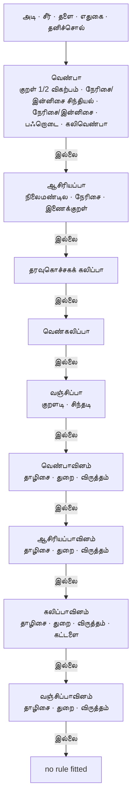

# Classical decision tree

First match wins. The ML verdict stays the primary metre. `classical_tree` sits beside it and records each check: rule id, pass or fail, Tamil sentence.

`MAJORITY_PERCENT` is 40, and a share must be strictly above it. வெண்கலிப்பா uses the same strict test: above 50 for கலி+வெண் and above 25 for கலி alone. கலிவெண்பா uses above 90 for வெண்டளை. அளவடி is 4 seers. மேற்கதுவாய் is seers 1, 3, 4 and does not gate. வஞ்சித்தாழிசை is 12 குறளடி. சிந்தடி வஞ்சி கனி 7/18 is kept: the share is rounded to one tenth, so 0.4 passes and 6/18 does not. Every named leaf has one Avalokitam `/types` example. ஆசிரிய ஒத்தாழிசை is a note on ஆசிரியத் தாழிசை, not its own leaf.
