# Classical decision tree

The ML verdict stays the primary metre. `classical_tree` sits beside it. A family gate is the shared combined conditions. Each leaf then has one or two discriminating rules. Those rules are the last step in the trace, `{leaf}.discriminator`, and the last node before the leaf in the diagram. Any failed condition rejects that leaf. More combined conditions run first. Equal counts keep Avalokitam's order.

One picture of every leaf was a single narrow column, so the diagram is an overview plus one sub-diagram per family.

## Overview

Family gates in strict-first order. A failed family drops to the next. Equal condition counts keep Avalokitam's order. Leaf discriminators are in the family diagrams.


[PNG](classical-tree.png)

```mermaid
%%{init: {"theme": "neutral", "themeVariables": {"fontFamily": "Noto Sans Tamil, Noto Sans, sans-serif", "fontSize": "15px"}, "flowchart": {"wrappingWidth": 420, "padding": 12, "htmlLabels": true, "curve": "linear", "nodeSpacing": 28, "rankSpacing": 36}}}%%
flowchart TD
  start["அடி<br/>சீர்<br/>தளை"]
  start --> aciriyappaa
  aciriyappaa["ஆசிரியப்பா<br/>8 combined<br/>3+ அடி<br/>இயற்சீர் மேல் 40<br/>ஆசிரியத்தளை மேல் 40<br/>ஈறு<br/>விளங்கனி இல்லை<br/>நீளம் இல்லை<br/>ஓர அளவடி<br/>இடை அடி"]
  aciriyappaa -->|இல்லை| kattalai_kalithurai
  kattalai_kalithurai["கட்டளைக்கலித்துறை<br/>6 combined<br/>4 நெடிலடி<br/>எதுகை<br/>16/17 எழுத்து<br/>அடிக்குள் வெண்"]
  kattalai_kalithurai -->|இல்லை| venpaa
  venpaa["வெண்பா<br/>4 combined<br/>ஈறு சிந்தடி<br/>உடல் சீர்<br/>வெண்டளை<br/>ஈற்றுச்சீர்"]
  venpaa -->|இல்லை| vanjippaa
  vanjippaa["வஞ்சிப்பா<br/>4 combined<br/>வஞ்சி அமைப்பு<br/>கனி பத்து<br/>வஞ்சித்தளை<br/>சுரிதகம்"]
  vanjippaa -->|இல்லை| aciriya_virutham
  aciriya_virutham["ஆசிரிய விருத்தம்<br/>4 combined<br/>4 சம அடி<br/>கழிநெடிலடி<br/>எதுகை"]
  aciriya_virutham -->|இல்லை| kattalai_kalippaa
  kattalai_kalippaa["கட்டளைக்கலிப்பா<br/>3 combined<br/>8 அரையடி<br/>4 சீர்<br/>11/12 எழுத்து"]
  kattalai_kalippaa -->|இல்லை| kalivenpaa_long_osai
  kalivenpaa_long_osai["கலிவெண்பா ஓசை<br/>2 combined<br/>13+ அடி<br/>ஈறு சிந்தடி"]
  kalivenpaa_long_osai -->|இல்லை| tharavukocha_kalippaa
  tharavukocha_kalippaa["தரவுகொச்சகம்<br/>2 combined<br/>4+ அளவடி"]
  tharavukocha_kalippaa -->|இல்லை| venkalippaa
  venkalippaa["வெண்கலிப்பா<br/>2 combined<br/>அளவடி+சிந்தடி<br/>உடல் சீர்"]
  venkalippaa -->|இல்லை| velivirutham
  velivirutham["வெளிவிருத்தம்<br/>2 combined<br/>3/4 நெடிலடி"]
  velivirutham -->|இல்லை| ventazhisai
  ventazhisai["வெண்டாழிசை<br/>2 combined<br/>3 அடி<br/>முதல் அளவடி"]
  ventazhisai -->|இல்லை| aciriya_thurai
  aciriya_thurai["ஆசிரியத் துறை<br/>2 combined<br/>4 அடி<br/>ஒரு அடி குறைவு"]
  aciriya_thurai -->|இல்லை| kurattazhisai
  kurattazhisai["குறட்டாழிசை<br/>1 combined<br/>2 அடி"]
  kurattazhisai -->|இல்லை| aciriya_thazhisai
  aciriya_thazhisai["ஆசிரியத் தாழிசை<br/>1 combined<br/>3 அடி"]
  aciriya_thazhisai -->|இல்லை| kalithurai
  kalithurai["கலித்துறை<br/>1 combined<br/>4 அடி"]
  kalithurai -->|இல்லை| kalivirutham
  kalivirutham["கலிவிருத்தம்<br/>1 combined<br/>4 அடி"]
  kalivirutham -->|இல்லை| vanjivirutham
  vanjivirutham["வஞ்சி விருத்தம்<br/>1 combined<br/>4 அடி"]
  vanjivirutham -->|இல்லை| vellathazhisai
  vellathazhisai["வெள்ளொத்தாழிசை<br/>1 combined<br/>9 அடி"]
  vellathazhisai -->|இல்லை| vendurai
  vendurai["வெண்டுறை<br/>1 combined<br/>3-7 அடி"]
  vendurai -->|இல்லை| kural_vensenthurai
  kural_vensenthurai["குறள் வெண்செந்துறை<br/>1 combined<br/>2 அடி"]
  kural_vensenthurai -->|இல்லை| kalithazhisai
  kalithazhisai["கலித்தாழிசை<br/>1 combined<br/>பல அடி"]
  kalithazhisai -->|இல்லை| vanjithazhisai
  vanjithazhisai["வஞ்சித்தாழிசை<br/>1 combined<br/>12 அடி"]
  vanjithazhisai -->|இல்லை| vanjithurai
  vanjithurai["வஞ்சித்துறை<br/>1 combined<br/>4 அடி"]
  vanjithurai -->|இல்லை| none["no rule fitted"]
```

## Venpaa

The வெண்பா gate is four combined conditions. Each leaf hangs off one discriminator node: line count, and for நேரிசை the தனிச்சொல் plus விகற்பம் mark. The long கலிவெண்பா ஓசை gate is separate; other families sit between it and the strict வெண்பா leaves.


[PNG](classical-tree-venpaa.png)

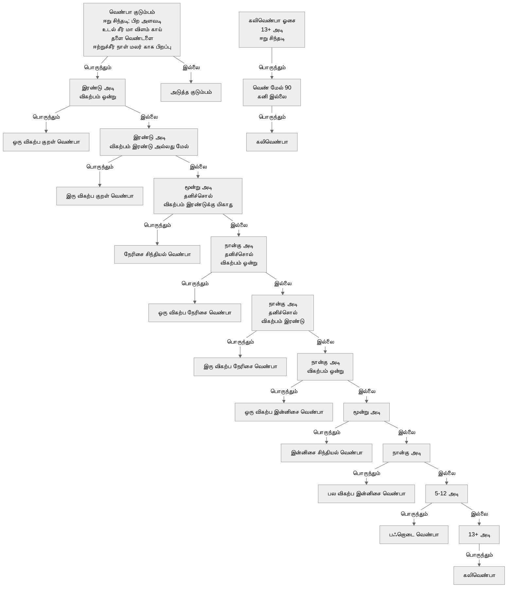

## Aciriyappaa

ஆசிரியப்பா shares eight conditions. The discriminator is where the short line sits. விருத்தம் then splits on சீர் count. தாழிசை and துறை split on line count and line length.


[PNG](classical-tree-aciriyappaa.png)

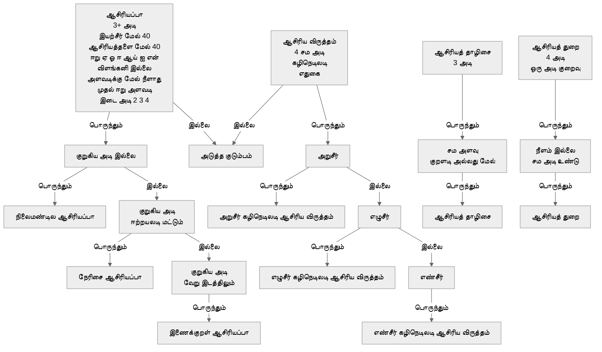

## Kalippaa

கட்டளைக்கலித்துறை is the heavy gate: the discriminator is the fifth seer and the ஏ ending. தாழிசை, துறை, and விருத்தம் split on line count and line length.

[PNG](classical-tree-kalippaa.png)

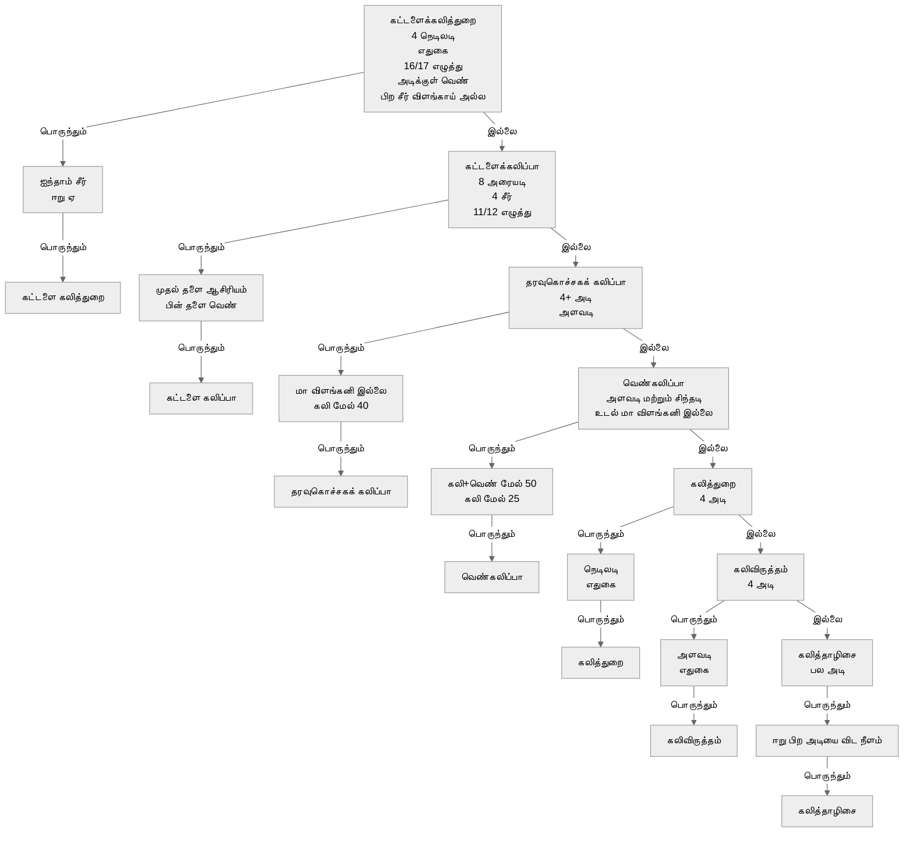

## Vanjippaa

வஞ்சிப்பா shares the skeleton. குறளடி and சிந்தடி are the discriminator. The பாவினம் leaves split on line count and line length.


[PNG](classical-tree-vanjippaa.png)

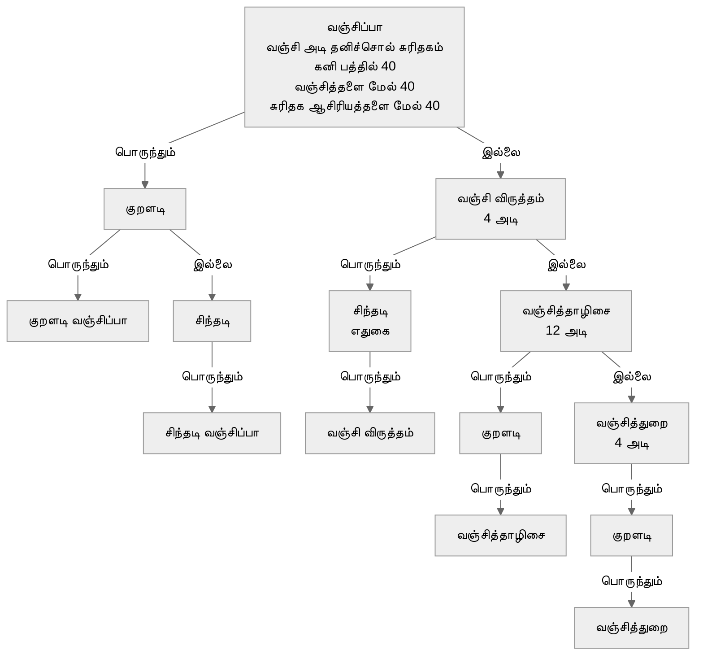

## Venpaavinam

வெளிவிருத்தம் is separated by one தனிச்சொல் and shared எதுகை. The other leaves are line count plus line length.


[PNG](classical-tree-venpaavinam.png)

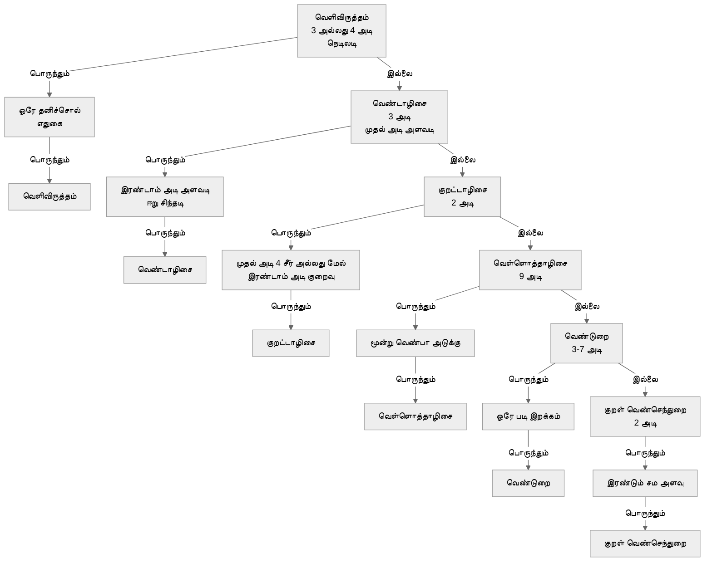

## Walk

The same order as a state chart. A state is a family gate or a leaf discriminator. பொருந்தும் ends on that leaf. இல்லை moves to the next discriminator. The family's இல்லை edge is the fall-through to the next family, including the miss after its last discriminator.


[PNG](classical-tree-walk.png)

Source: [classical-tree-walk.mmd](classical-tree-walk.mmd). `walk_state_chart_mermaid` writes it. `UPDATE_CLASSICAL_WALK=1 cargo test --lib walk_state_chart_matches_the_committed_diagram` refreshes the file. The PNG is rendered with [classical-tree-walk.css](classical-tree-walk.css) so the edge labels use Noto Sans Tamil.

## Decision routes

Each inconsistency is a named route in `tamil-seiyul-alagi/src/classical_decision.rs`. The trace records the route that is in force. A `decision.*` step means that route was the one applied.

| Inconsistency | Route in force | Source |
| --- | --- | --- |
| Shares above 40, 50, 25, and 90 | `ShareRoute::StrictAbove` | site |
| சிந்தடி வஞ்சி கனி, 7/18 passes and 6/18 fails | `ShareRoute::RoundToTenth` | site |
| அளவடி is 4 seers | `AlavadiWordRoute::FourSeers` | treatise |
| மேற்கதுவாய் seats 1, 3, 4 | `MerkathuvaiSeatRoute::TreatiseOneThreeFour` | treatise |
| Fifth seer accepts விளங்காய், மாங்கனி, and மாந்தண்பூ | `FifthSeerRoute::TreatisePlusSiteStandIns` | treatise and site |
| தரவுகொச்சகம் is four or more அளவடி | `TharavuAlavadiRoute::FourOrMore` | treatise |
| நேரிசை stays one mark and ties with குறள் | `NerisaiTieRoute::CombinedMarkAvalokitamRank` | site |
| Strict-first, Avalokitam rank on a tie | `WalkOrderRoute::StrictFirstAvalokitamTie` | site |
| Repeated line-final தனிச்சொல் on the four-line probe | `RepeatedTanicholRoute::KeepStrictFirstKattalai` | site |
| கலிவெண்பா strict versus long ஓசை, same leaf id | `decision.kalivenpaa_route` names the gate | site |

The four abstract order pairs are recorded as `decision.order.kattalai_kalithurai_velivirutham`, `decision.order.aciriyappaa_kural_venpaa`, `decision.order.kattalai_kalippaa_tharavu`, and `decision.order.vanjippaa_kalivenpaa_osai`.

Owner decision: four copies of `கனந்தரும் பூங்குழ லாளபி ராமி - கடைக்கண்களே` are strict-first கட்டளைக்கலித்துறை and Avalokitam வெளிவிருத்தம். The route in force keeps கட்டளைக்கலித்துறை. `RejectRepeatedLineFinalTanichol` and `VenpaaVinamBeforeKalippaaVinam` are named and not chosen; either one would move that leaf to வெளிவிருத்தம். The trace step is `decision.repeated_tanichol`.

பா over பாவினம் is an allowed overlap. Both orders return the பா: குறள் வெண்பா over குறட்டாழிசை, சிந்தியல் over வெண்டாழிசை and வெண்டுறை, தரவு over கலிவிருத்தம், ஆசிரியப்பா over துறை and தாழிசை. Those pairs are not order counterexamples.

`kalivenpaa_strict` and `kalivenpaa_long_osai` both report leaf id `kalivenpaa`. `decision.kalivenpaa_route` names which gate won.

## Inconsistencies

Site-tuned thresholds:

- இயற்சீர், ஆசிரியத்தளை, கலித்தளை, வஞ்சித்தளை, and சுரிதக ஆசிரியத்தளை must be strictly above 40. An exact 40 percent share fails.
- வெண்கலிப்பா must be strictly above 50 for கலி+வெண் and strictly above 25 for கலி alone.
- கலிவெண்பா's long ஓசை gate must be strictly above 90 வெண்டளை.
- சிந்தடி வஞ்சி கனி is the exception: 7/18 rounds to one tenth and passes; 6/18 rounds to 0.3 and fails. The other percent gates do not round.
- அளவடி is 4 seers. The site sometimes uses that word for a line in general.
- மேற்கதுவாய் is recorded as seers 1, 3, and 4. The site text says 1, 2, 3. It is a note, not a gate.
- கட்டளைக்கலித்துறை's fifth seer accepts விளங்காய் or the site's rare மாங்கனி and மாந்தண்பூ. The published example's last fifth seer is புளிமாங்கனி.
- தரவுகொச்சகக் கலிப்பா matches four or more அளவடி. The Tamil success line says நான்கு அளவடிக்கு மேல்.
- நேரிசை records தனிச்சொல் and விகற்பம் as one mark. Those three leaves therefore have 6 combined conditions and tie with குறள் வெண்பா. Avalokitam rank still tries குறள் first. The line counts do not overlap, so the leaf does not move.

Order-dependent verdicts. Avalokitam walks families first. Strict-first walks condition count first. Where those orders disagree:

- கட்டளைக்கலித்துறை (8) is before வெளிவிருத்தம் (4). Avalokitam checks வெளிவிருத்தம் first. Four copies of `கனந்தரும் பூங்குழ லாளபி ராமி - கடைக்கண்களே` (4 நெடிலடி, எதுகை, repeated line-final தனிச்சொல்) are the one poem that takes both gates. Strict-first returns கட்டளைக்கலித்துறை. Avalokitam returns வெளிவிருத்தம். The chosen route keeps கட்டளைக்கலித்துறை. The `/types` rows do not include this probe.
- ஆசிரியப்பா (9) is before வெண்பா. A குறள் still fails ஆசிரியப்பா because the last line is சிந்தடி, so the leaf stays குறள் வெண்பா.
- கட்டளைக்கலிப்பா (5) is before தரவுகொச்சகக் கலிப்பா (4). The published கட்டளை example has no கலித்தளை above 40, so தரவு fails and the leaf stays.
- வஞ்சிப்பா (5) is before the long கலிவெண்பா ஓசை gate (4). The published கலிவெண்பா has no வஞ்சி skeleton, so the leaf stays.
- Equal counts keep Avalokitam's order. வெண்கலிப்பா and வெண்டாழிசை both have 4 conditions, and வெண்கலிப்பா is still tried first.

All 36 `/types` examples keep the same leaf under both orders. ஆசிரிய ஒத்தாழிசை is a note on ஆசிரியத் தாழிசை, not its own leaf.
